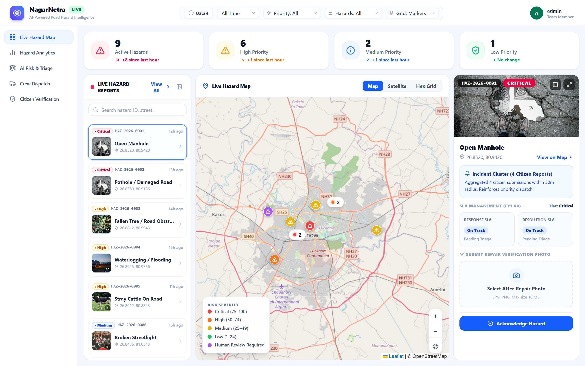
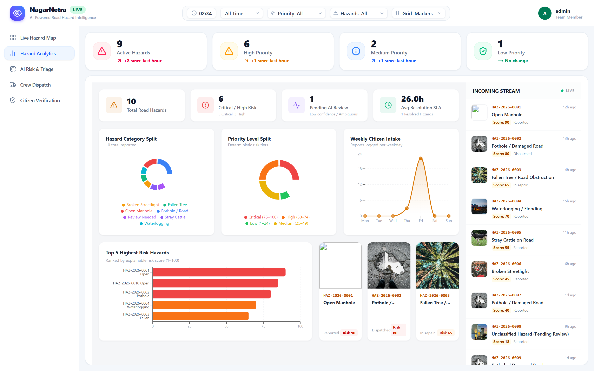
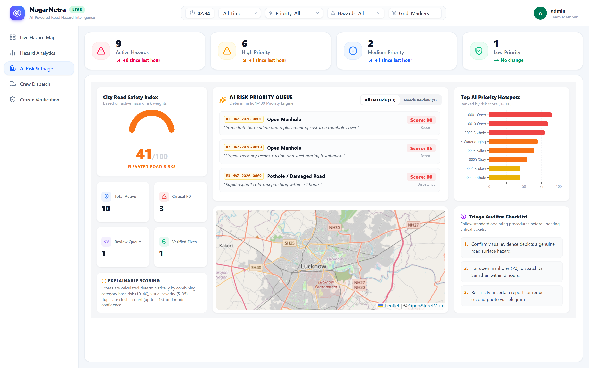
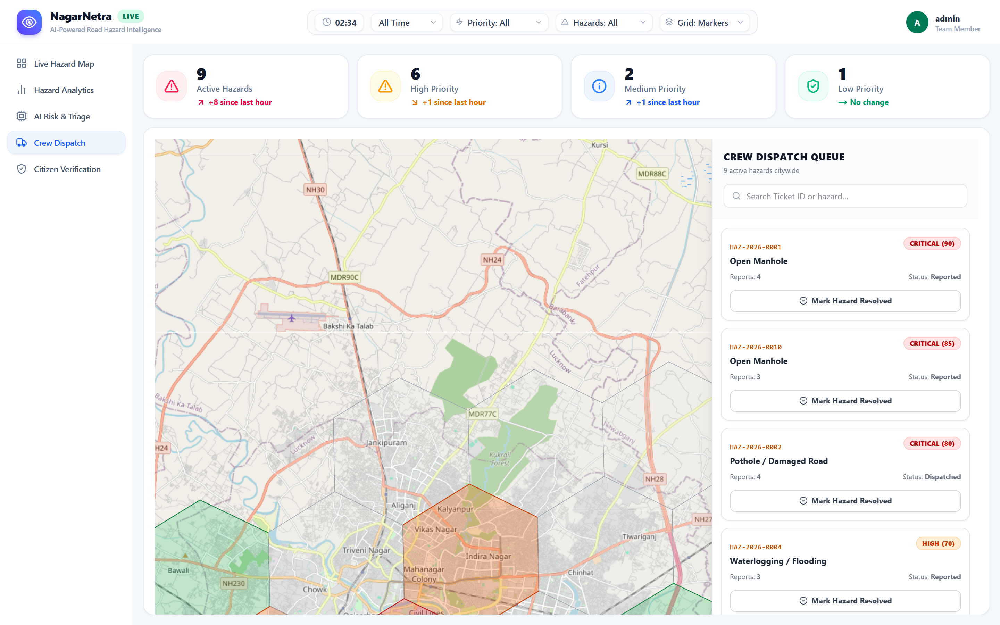
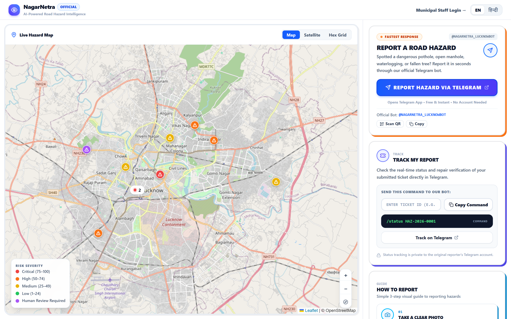
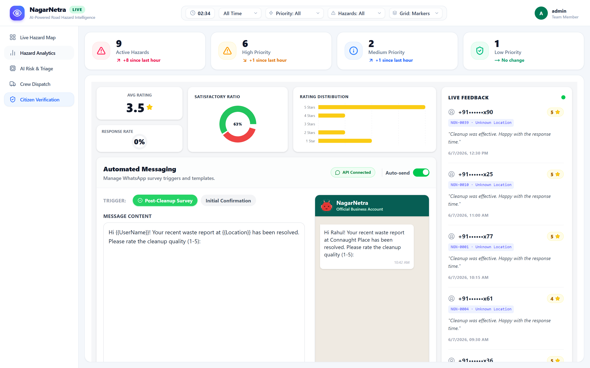
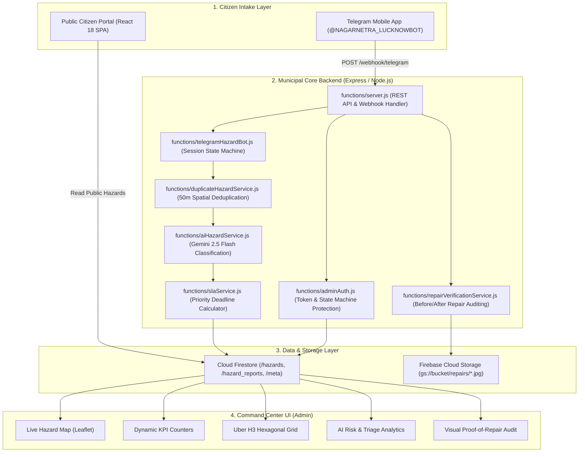

<div align="center">
  
  
  # SI-02: NagarNetra Road Hazard Intelligence System
  **AI-Powered Municipal Road Safety, Spatial Triage, and Verified Repair Infrastructure**

  [](https://github.com/yogendra12tiwari/nagarnetra-road-safety)
  [](https://react.dev/)
  [](https://vitejs.dev/)
  [](https://ai.google.dev/)
  [](https://firebase.google.com/)
  [](https://core.telegram.org/bots)
  [](file:///d:/NagarNetra/functions/tests)
  [](https://oxc.rs/)
</div>

---

## 📋 Table of Contents

- [1. Executive Overview \& Problem Statement](#1-executive-overview--problem-statement)
- [2. Key System Capabilities](#2-key-system-capabilities)
- [3. Application Screenshots Gallery](#3-application-screenshots-gallery)
  - [3.1 Live Hazard Map \& Municipal Command Center](#31-live-hazard-map--municipal-command-center)
  - [3.2 AI Risk \& Triage Analytics](#32-ai-risk--triage-analytics)
  - [3.3 Municipal Insights \& SLA Performance Dashboard](#33-municipal-insights--sla-performance-dashboard)
  - [3.4 Crew Coordination \& Zone Dispatch Queue](#34-crew-coordination--zone-dispatch-queue)
  - [3.5 Citizen Reporting \& Tracking Portal](#35-citizen-reporting--tracking-portal)
  - [3.6 Repair Verification \& Evidence Auditing](#36-repair-verification--evidence-auditing)
- [4. Dashboard Panels Explained](#4-dashboard-panels-explained)
- [5. End-to-End Operational Lifecycle](#5-end-to-end-operational-lifecycle)
- [6. System Architecture](#6-system-architecture)
- [7. Verified Technology Stack](#7-verified-technology-stack)
- [8. Repository Structure](#8-repository-structure)
- [9. Prerequisites \& Local Installation](#9-prerequisites--local-installation)
- [10. Environment Variables \& Configuration](#10-environment-variables--configuration)
- [11. Local Development Commands](#11-local-development-commands)
- [12. API Reference \& Authentication Standards](#12-api-reference--authentication-standards)
- [13. Firebase, Firestore \& Cloud Storage Setup](#13-firebase-firestore--cloud-storage-setup)
- [14. Telegram Bot \& Webhook Integration](#14-telegram-bot--webhook-integration)
- [15. SLA Deadlines \& Escalation Engine](#15-sla-deadlines--escalation-engine)
- [16. Deployment Architecture \& Hosting Requirements](#16-deployment-architecture--hosting-requirements)
- [17. Automated Testing Results](#17-automated-testing-results)
- [18. Security, Privacy \& Citizen Protection](#18-security-privacy--citizen-protection)
- [19. Known Limitations \& Roadmap](#19-known-limitations--roadmap)
- [20. Contribution Guidelines \& Project Status](#20-contribution-guidelines--project-status)

---

## 1. Executive Overview & Problem Statement

Road hazards—such as deep craters, collapsed sewer grates, open manholes, seasonal waterlogging, and fallen trees—are a major contributor to vehicular accidents and fatalities on urban corridors. According to official annual reports from the Ministry of Road Transport and Highways (MoRTH, Government of India), road crashes claim over **150,000 to 168,000 lives annually** across the nation, with sudden road surface defects and unattended physical hazards posing acute dangers to two-wheelers and commercial traffic.

### The Breakdown in Legacy Civic Systems
Municipal corporations and Public Works Departments (PWD) face chronic operational friction when managing road safety:
1. **The Reporting Friction Barrier:** Traditional 311 systems require citizens to download standalone mobile applications, endure SMS OTP delays, or navigate confusing multi-page forms. Over 90% of commuters simply bypass reporting as a result.
2. **The Duplicate Tsunami:** When a severe pothole opens on an arterial corridor, multiple citizens submit independent complaints. Legacy ticketing systems treat each report as an isolated incident, generating redundant inspections, duplicate work orders, and wasted municipal fuel.
3. **Absence of Explainable Risk Scoring:** In legacy workflows, tickets are sorted strictly chronologically (First-In, First-Out). A minor hairline crack reported early in the morning takes administrative precedence over a lethal open manhole reported five minutes later.
4. **The Ghost-Repair Feedback Loop:** Maintenance contractors frequently mark tickets "Resolved" without verifiable proof. Field crews submit false completion notices, while citizens have no transparent mechanism to audit repairs or reopen unfinished work.

### The NagarNetra SI-02 Solution
**NagarNetra SI-02** is an end-to-end Road Hazard Intelligence System that unifies frictionless citizen reporting with an automated AI command center:
- **Zero-Download Intake:** Citizens report hazards in under 30 seconds via Telegram (`@NAGARNETRA_LUCKNOWBOT`) by sharing a photo and GPS location pin.
- **Multimodal AI Classification:** Google Gemini 2.5 Flash analyzes road hazard images, classifies the category, detects visual severity, and flags dubious uploads for human operator triage.
- **50-Meter Haversine Spatial Deduplication:** Incoming reports within 50 meters of an active hazard are atomically clustered, preventing duplicate dispatches while dynamically escalating the incident's risk score.
- **Deterministic 1–100 Risk Engine:** Calculates priority based on physical defect severity, spatial density, cluster frequency, and road hierarchy.
- **Dual Before/After Visual Repair Auditing:** Field crews must submit photographic repair evidence to the system. Gemini AI conducts a structural comparison against the original citizen photo, validating actual asphalt restoration before closing tickets.

---

## 2. Key System Capabilities

- 🤖 **Multimodal Vision Classification:** Automated recognition of 6 canonical hazard categories: *Pothole / damaged road*, *Open manhole*, *Waterlogging*, *Fallen tree / road obstruction*, *Broken streetlight*, and *Stray cattle*.
- 📍 **50-Meter Spatial Deduplication:** Haversine formula clustering links secondary reports to a lead canonical incident, tracking total affected citizen count without polluting dispatch queues.
- ⚡ **Automated SLA Countdown Engine:** Priority-based Service Level Agreements (Critical: 2h response / 24h resolution; High: 6h / 48h; Medium: 24h / 168h; Low: 48h / 336h) evaluated on demand.
- 🛡️ **Proof-of-Repair Visual Verification:** Crew repair photos are evaluated by Gemini AI for structural patch adequacy, compaction quality, and hazard elimination before status transitions to `resolved`.
- 🗺️ **Uber H3 Hexagonal Grid Clustering:** High-speed spatial partitioning (H3 resolution 6, covering Lucknow municipal wards at ~36 km² per hex) highlights zones requiring aggregate crew deployment.
- 🔒 **Role-Based Security & PII Protection:** Citizen phone numbers, Telegram user IDs, and raw chat logs are isolated in backend-only collections. Public maps expose zero citizen identifiable data.
- 🧪 **Comprehensive Automated Verification:** 55 unit tests covering admin authorization, state machine transitions, AI error fallbacks, spatial deduplication, and repair auditing.

---

## 3. Application Screenshots Gallery

All screenshots below represent the **actual, fully-implemented UI** running in the local development environment (`http://localhost:5173`) with representative sample datasets for Lucknow municipal road operations.

---

### 3.1 Live Hazard Map & Municipal Command Center

<div align="center">
  
</div>

* **File:** [`docs/screenshots/command-center.png`](docs/screenshots/command-center.png)
* **Target User:** Municipal Operations Director, PWD Chief Engineer, Emergency Dispatch Operators.
* **Operational Scope:** Real-time situational awareness across the municipal road network. Features color-coded hazard severity markers (Critical Red, High Orange, Medium Yellow, Low Green), dynamic summary KPI counters (Total Road Hazards, High Risk, In Repair, Resolved), category filters, and an interactive Leaflet mapping engine.
* **Workflow:** Operators inspect live incident pins, filter by hazard category or priority, click individual markers to inspect ticket history, and track real-time crew assignment statuses.

---

### 3.2 AI Risk & Triage Analytics

<div align="center">
  
</div>

* **File:** [`docs/screenshots/ai-risk-triage.png`](docs/screenshots/ai-risk-triage.png)
* **Target User:** AI Triage Officers, Urban Safety Analysts, Quality Assurance Engineers.
* **Operational Scope:** Statistical breakdown of road network integrity. Displays hazard category distribution donuts, visual severity level splits, and the Top 5 Highest Risk Hazards ranked by the explainable 1–100 risk algorithm.
* **Workflow:** Operators identify which physical road defects are accelerating in volume (e.g., post-monsoon pothole spikes vs. open sewer cover theft) to allocate asphalt and civil engineering budget proactively.

---

### 3.3 Municipal Insights & SLA Performance Dashboard

<div align="center">
  
</div>

* **File:** [`docs/screenshots/municipal-insights-sla.png`](docs/screenshots/municipal-insights-sla.png)
* **Target User:** Municipal Commissioner, Ward Officers, SLA Compliance Auditors.
* **Operational Scope:** Service Level Agreement compliance monitoring. Tracks active tickets approaching deadline breaches, historical resolution velocity, and breakdown of priority band response times.
* **Workflow:** Department heads evaluate whether ward contractors are meeting statutory turnaround commitments (e.g., Critical response within 2 hours) and investigate overdue incident clusters.

---

### 3.4 Crew Coordination & Zone Dispatch Queue

<div align="center">
  
</div>

* **File:** [`docs/screenshots/crew-coordination.png`](docs/screenshots/crew-coordination.png)
* **Target User:** Field Crew Supervisors, Dispatch Coordinators, Road Maintenance Contractors.
* **Operational Scope:** Geographic work-order grouping using Uber H3 hexagonal spatial partitioning (resolution 6). Clusters individual road defects into contiguous ward zones to minimize asphalt truck transit time.
* **Workflow:** Supervisors select an active H3 cell on the map, review all pending tickets in that zone from the right dispatch queue, assign a specific asphalt crew, and issue bulk dispatch commands.

---

### 3.5 Citizen Reporting & Tracking Portal

<div align="center">
  
</div>

* **File:** [`docs/screenshots/citizen-reporting.png`](docs/screenshots/citizen-reporting.png)
* **Target User:** Citizens, Commuters, Cyclists, Local Neighborhood Residents.
* **Operational Scope:** Clean, presentation-ready white interface displaying verified public road hazard markers on an interactive map, paired with a right-hand action sidebar.
* **Workflow:** Citizens browse nearby road safety hazards, click the prominent **"Report a Road Hazard"** CTA to deep-link directly into the verified Telegram bot (`@NAGARNETRA_LUCKNOWBOT`), track existing ticket IDs via `/status`, and read clear guidance on safe location sharing.

---

### 3.6 Repair Verification & Evidence Auditing

<div align="center">
  
</div>

* **File:** [`docs/screenshots/hazard-repair-verification.png`](docs/screenshots/hazard-repair-verification.png)
* **Target User:** Municipal Verification Officers, Citizen Grievance Inspectors, Independent Auditors.
* **Operational Scope:** Dual-evidence validation table. Audits field repair photos against original citizen submission photos, displaying Gemini AI verification scores, confidence percentages, and manual override controls.
* **Workflow:** When a field crew uploads an "After repair" photo, the AI model checks for asphalt patch presence and quality. If confidence is below 0.70 or uncertain, the ticket is flagged for mandatory human sign-off before closure.

---

## 4. Dashboard Panels Explained

| Panel Name | Route / Tab | Primary User | Key Information Visible | Workflow | Operational Value | Implementation Status |
|---|---|---|---|---|---|---|
| **Live Hazard Map** | `/admin` (`rawfeed`) | Dispatchers, Operators | Leaflet map with cluster markers, KPI summary cards, Category/Priority filters, Hazard detail drawer | Filter by category, click marker, review history, update status or dispatch crew | Eliminates blind dispatching; provides instant situational awareness | **Implemented & Verified** (Live Firestore or offline mock) |
| **Hazard Analytics** | `/admin` (`analysis`) | Safety Analysts | Donut category split, Severity bar charts, Top 5 Highest Risk Hazards list (1–100) | Review defect trends, inspect high-risk incidents, identify defect clusters | Quantifies defect patterns and high-risk corridors | **Implemented & Verified** (Calculated from active hazard data) |
| **AI Risk & Triage** | `/admin` (`insights`) | Ward Officers | Radial SLA meters, Priority compliance charts, Resolution velocity tracker | Monitor on-track vs. approaching vs. breached tickets, track average turnaround | Enforces accountability and prevents SLA breaches | **Implemented & Verified** (Evaluated on-demand via `slaService`) |
| **Crew Dispatch** | `/admin` (`coordination`) | Field Supervisors | Uber H3 resolution 6 hex grid, Zone dispatch sidebar, Team assignment selectors | Click hexagon cell, view ward tickets, assign crew (e.g. Rapid Asphalt Team A) | Reduces truck travel time by clustering nearby repairs | **Implemented & Verified** (Interactive H3 partitioning) |
| **Citizen Portal** | `/` (Public root) | Commuters, Citizens | Public hazard map, Telegram bot CTA, Ticket tracking widget, 3-step guide | Browse map, deep-link to Telegram bot, check ticket status via `/status` | Zero-barrier intake with 100% public transparency | **Implemented & Verified** (White minimalist mobile-first UI) |
| **Citizen Verification** | `/admin` (`feedback`) | Compliance Auditors | Evidence comparison tables, AI confidence badges, Manual verify buttons | Review Before/After photos, inspect Gemini confidence, click Manual Verify/Reject | Prevents ghost repairs and contractor fraud | **Implemented & Verified** (Gemini multimodal & manual override) |

---

## 5. End-to-End Operational Lifecycle

```
[ Citizen on Road ]
       │
       ▼
 1. Telegram Bot Intake  ──►  Sends photo + GPS pin to @NAGARNETRA_LUCKNOWBOT
       │
       ▼
 2. Ingestion & Spatial Check ──► Backend checks 50m radius via Haversine formula
       ├─ Duplicate found (≤50m) ──► Links to existing cluster; increments report count
       └─ New hazard (>50m)      ──► Generates collision-safe ticket (HAZ-2026-XXXX)
       │
       ▼
 3. Multimodal AI Triage ──► Google Gemini 2.5 Flash analyzes road hazard image
       ├─ Valid category (Pothole, Manhole, etc.) ──► Computes Risk Score (1-100)
       └─ Uncertain/Irrelevant image             ──► Flags needs_human_review: true
       │
       ▼
 4. Municipal Dispatch   ──► Command Center assigns crew; SLA countdown starts
       │
       ▼
 5. Field Repair Upload  ──► Maintenance crew submits "After-repair" photo evidence
       │
       ▼
 6. AI Verification      ──► Gemini compares Before vs. After; checks compaction
       ├─ Confident (≥0.70) ──► Transitions to status: "resolved"; records resolved_at
       └─ Uncertain (<0.70) ──► Routes to manual supervisor review queue
       │
       ▼
 7. Citizen Notification ──► Telegram bot reports updated status to citizen on /status
```

---

## 6. System Architecture



---

## 7. Verified Technology Stack

| Domain | Technology | Version | Purpose |
|---|---|---|---|
| **Frontend Framework** | React | `^18.3.1` | Component-driven reactive user interface |
| **Build Tool** | Vite | `^8.1.3` | High-speed ESM bundling and client dev server |
| **Styling** | Tailwind CSS | `^3.4.1` | Utility-first responsive design system |
| **Iconography** | Lucide React | `^1.16.0` | Accessible SVG interface iconography |
| **Geospatial Mapping** | Leaflet / React-Leaflet | `^1.9.4` / `^4.2.1` | Interactive tile mapping and hazard pin rendering |
| **Hex Partitioning** | Uber H3-JS | `^4.1.0` | Hexagonal spatial indexing and cluster visualization (resolution 6) |
| **Data Visualization** | Recharts | `^2.15.1` | Responsive municipal analytics and SLA meters |
| **Backend Runtime** | Node.js | `>=20.0.0` | High-performance asynchronous JavaScript engine |
| **Backend Framework** | Express | `^4.19.2` | REST API routing, webhook parsing, and middleware |
| **Database** | Cloud Firestore | SDK `^12.1.0` | Real-time NoSQL document store with live listeners |
| **Photo Storage** | Firebase Cloud Storage | SDK `^12.1.0` | Secure object storage for crew repair verification photos |
| **AI Vision Engine** | Google Gemini 2.5 Flash | REST / SDK | Multimodal hazard classification and repair verification |
| **Messaging Gateway** | Telegram Bot API | Webhook 2.0 | Conversational intake and status reporting |
| **Test Runner** | Node.js Test Runner | Native (`node:test`) | Zero-dependency automated unit test suite (55 tests) |
| **Linter** | Oxlint | `^1.60.0` | High-speed Rust-based JavaScript/React linter |

---

## 8. Repository Structure

```
d:/NagarNetra/
├── .env.example                     # Environment template with dummy placeholders only
├── .firebaserc                      # Firebase project target (nagarnetra-road-safety)
├── .gitignore                       # Strict exclusion of .env, keys, credentials, and uploads
├── firestore.rules                  # Role-based security rules enforcing PII protection
├── firebase.json                    # Firebase hosting, functions, and rules configuration
├── package.json                     # Root npm scripts, frontend dependencies, test runners
├── README.md                        # Primary project documentation
├── docs/
│   └── screenshots/                 # High-resolution application screenshots
│       ├── command-center.png       # Live Hazard Map & Command Center
│       ├── ai-risk-triage.png       # AI Risk & Triage Analytics Panel
│       ├── municipal-insights-sla.png# Municipal SLA & Insights Panel
│       ├── crew-coordination.png    # Crew Dispatch & Zone Coordination
│       ├── citizen-reporting.png    # Public Citizen Reporting Portal
│       └── hazard-repair-verification.png # Proof-of-Repair Verification Audit
├── functions/                       # Backend Express & Cloud Functions service
│   ├── adminAuth.js                 # Admin token verification and state machine guard
│   ├── aiHazardService.js           # Gemini 2.5 Flash multimodal vision & risk scoring
│   ├── duplicateHazardService.js    # 50m Haversine spatial deduplication engine
│   ├── index.js                     # Firebase Cloud Functions HTTPS entry point
│   ├── package.json                 # Backend dependencies and node --test script
│   ├── repairVerificationService.js # Dual Before/After repair photo audit & cloud storage
│   ├── seedFirestore.js             # Canonical Lucknow seed dataset migration script
│   ├── server.js                    # Standalone Express production API server
│   ├── slaService.js                # Priority SLA countdown and escalation tracker
│   ├── telegramHazardBot.js         # Telegram conversational intake state machine
│   └── tests/                       # 55 automated backend unit tests
│       ├── adminAuth.test.js        # 10 tests: token auth, immutable fields, transitions
│       ├── aiHazardService.test.js  # 10 tests: Gemini vision, risk score, fallback
│       ├── duplicateDetection.test.js# 8 tests: Haversine distance, cluster increment
│       ├── hazardBot.test.js        # 10 tests: Telegram /report, photo, GPS, /status
│       ├── repairVerification.test.js# 9 tests: MIME validation, Before/After audit
│       └── slaService.test.js       # 7 tests: SLA deadlines, breach evaluation
├── public/                          # Static web assets, logos, and QR codes
│   ├── favicon.svg                  # Brand favicon
│   ├── nagarnetra-logo.png          # High-resolution brand logo
│   └── nagarnetra-telegram-qr.png   # Scannable Telegram bot QR code
├── scripts/                         # Operational and screenshot automation scripts
│   └── capture_screenshots.js       # Puppeteer automation script for documentation
└── src/                             # React 18 frontend source code
    ├── App.jsx                      # Root application router and Firestore sync
    ├── index.css                    # Tailwind CSS configuration and theme tokens
    ├── main.jsx                     # DOM root mount
    ├── components/                  # Shared UI components
    │   ├── AdminLogin.jsx           # Admin authentication modal with demo bypass
    │   ├── ClusterLayer.jsx         # Leaflet marker clustering and severity pin styling
    │   ├── HexGridLayer.jsx         # Uber H3 hexagonal polygon rendering layer
    │   ├── KpiCards.jsx             # Top summary KPI metric widgets
    │   ├── NagarNetraLogo.jsx       # Brand SVG logo header component
    │   ├── Sidebar.jsx              # Collapsible municipal sidebar navigation
    │   ├── SplashScreen.jsx         # Startup lifecycle animated splash screen
    │   ├── TabBar.jsx               # Tab switching controls
    │   ├── TopBar.jsx               # Municipal filter dropdowns and user profile
    │   ├── TopHeader.jsx            # Real-time telemetry header
    │   └── tabs/                    # Primary dashboard workspace views
    │       ├── AnalysisTab.jsx      # Hazard Analytics & category split
    │       ├── CoordinationTab.jsx  # Crew Dispatch & zone coordination queue
    │       ├── FeedbackTab.jsx      # Citizen Verification & repair auditing
    │       ├── InsightsTab.jsx      # AI Risk & Triage SLA dashboard
    │       └── MapTab.jsx           # Live interactive road hazard map
    ├── data/
    │   └── mockData.js              # Canonical Lucknow road hazard test datasets
    ├── pages/
    │   ├── AdminPanel.jsx           # Municipal Command Center root page
    │   └── PublicDashboard.jsx      # White minimalist Citizen Portal root page
    └── services/
        ├── firebase.js              # Client Firebase SDK initialization
        └── gemini.js                # Client Gemini AI service integration
```

---

## 9. Prerequisites & Local Installation

### Prerequisites
- **Node.js:** `v20.0.0` or higher (tested with Node.js v22).
- **npm:** `v10.0.0` or higher.
- **Git:** Installed and configured.

### Step-by-Step Installation

```bash
# 1. Clone the repository
git clone https://github.com/yogendra12tiwari/nagarnetra-road-safety.git
cd nagarnetra-road-safety

# 2. Install root and frontend dependencies
npm install

# 3. Install backend Cloud Functions dependencies
cd functions
npm install
cd ..

# 4. Copy the environment configuration template
cp .env.example .env
```

---

## 10. Environment Variables & Configuration

> [!CAUTION]
> **Secret Protection:** Never commit the `.env` file, service account keys, or API tokens to version control. The `.gitignore` file is strictly configured to ignore all `.env*` files and `*serviceAccount*.json` credentials.

Configure the following variables in your local `.env` file (or your hosting provider's secret dashboard):

| Variable Name | Required? | Scope | Purpose | Sample Format / Default |
|---|---|---|---|---|
| `GEMINI_API_KEY` | **Required** | Backend | Multimodal AI classification and Before/After repair verification | `AIzaSy...` (from Google AI Studio) |
| `GEMINI_MODEL` | Optional | Backend | Model identifier for multimodal triage | `gemini-2.5-flash` |
| `TELEGRAM_BOT_TOKEN` | **Required** | Backend | Telegram Bot token for intake and messaging | `123456789:ABC-DEF...` (from @BotFather) |
| `TELEGRAM_WEBHOOK_SECRET`| **Required (Prod)** | Backend | Validates `X-Telegram-Bot-Api-Secret-Token` | Random 32-character string |
| `ADMIN_SECRET` | **Required** | Backend | Protects `/api/hazards/*` status updates, repairs, and webhooks | Strong random alphanumeric secret |
| `FIREBASE_PROJECT_ID` | **Required** | Backend | Target Firebase Project | `nagarnetra-road-safety` |
| `FIREBASE_SERVICE_ACCOUNT_KEY` | **Required (Prod)**| Backend | Service account JSON (raw or base64) | `{"type":"service_account",...}` |
| `FIREBASE_STORAGE_BUCKET`| Optional (Dev) | Backend | Cloud Storage bucket for crew repair photos | `nagarnetra-road-safety.firebasestorage.app` |
| `PORT` | Optional | Backend | Port for Express server | `3000` |
| `TELEGRAM_WEBHOOK_BASE_URL`| Optional (Prod)| Backend | Public backend HTTPS URL for webhook setup | `https://nagarnetra-74tc.onrender.com` |
| `VITE_FIREBASE_API_KEY` | **Required** | Frontend | Web API Key for client Firebase SDK | `AIzaSy...` |
| `VITE_FIREBASE_AUTH_DOMAIN`| **Required** | Frontend | Client Firebase Auth domain | `nagarnetra-road-safety.firebaseapp.com` |
| `VITE_FIREBASE_PROJECT_ID` | **Required** | Frontend | Client Firestore project ID | `nagarnetra-road-safety` |
| `VITE_FIREBASE_APP_ID` | **Required** | Frontend | Web Client Application ID | `1:000000000000:web:0000000...` |
| `VITE_BACKEND_URL` | **Required** | Frontend | Backend API base URL | `http://localhost:3000` (Dev) |
| `VITE_TELEGRAM_BOT_USERNAME`| **Required** | Frontend | Public bot username for citizen CTAs | `NAGARNETRA_LUCKNOWBOT` (without `@`) |

---

## 11. Local Development Commands

Open two terminal windows to run both the frontend and backend locally:

### Terminal 1: Backend Express API Server
```bash
# Starts the Express API server on http://localhost:3000
node functions/server.js
```

### Terminal 2: Vite Frontend Development Server
```bash
# Starts Vite client server with hot module replacement on http://localhost:5173
npm run dev
```

### Additional Verification Commands
```bash
# Execute the full 55-test backend automated test suite
npm run test:backend

# Run Vite production client build
npm run build

# Run Oxlint high-speed code linter
npm run lint

# Preview production build locally
npm run preview
```

---

## 12. API Reference & Authentication Standards

The backend service (`functions/server.js`) exposes RESTful endpoints with strict CORS controls and role-based header validation.

### Public Endpoints
- `GET /health` — Verifies backend service health, Firestore connectivity, and service configuration.
- `GET /telegram/health` — Probes Telegram bot configuration and webhook secret status.
- `GET /api/hazards` — Returns the canonical list of active road hazards (sanitized; citizen PII removed).
- `GET /api/hazards/:id/cluster` — Retrieves all secondary reports linked within 50 meters of a canonical hazard.
- `POST /webhook/telegram` — Receives incoming Telegram update payloads. Verified via `X-Telegram-Bot-Api-Secret-Token`.
- `GET /api/repairs/photos/:filename` — Serves local repair evidence photos with path traversal protection.

### Protected Municipal Endpoints
All administrative endpoints require either:
1. `Authorization: Bearer <Firebase_ID_Token>` containing the custom claim `admin: true` or `role: "admin"`.
2. `X-Admin-Secret: <ADMIN_SECRET>` header matching the server's configured secret.

- `PATCH /api/hazards/:id/status` — Updates hazard status, notes, or assigned team. Enforces valid state machine transitions:
  `reported` ➔ `acknowledged` ➔ `dispatched` ➔ `in_repair` ➔ `resolved`.
  *Note:* Immutable fields (`ticket_id`, `lat`, `lng`, `photos`, `created_at`) are cryptographically rejected from mutation.
- `POST /api/hazards/:id/verify-repair` — Multipart form accepting `ticket_id`, `repair_photo` (JPEG, PNG, WebP up to 10 MB), and `notes`. Executes Gemini Before/After evaluation and uploads to Cloud Storage.
- `POST /api/hazards/:id/manual-verify` — Allows an authorized supervisor to override automated verification (`decision: "verified" | "not_verified"`).
- `GET /api/sla/summary` — Returns aggregate SLA metrics (on-track, approaching, breached, turnaround velocity).
- `POST /api/sla/evaluate` — Evaluates active SLA deadlines on-demand for specified or all pending hazards.
- `ALL /api/telegram/set-webhook` — Registers the backend endpoint (`/webhook/telegram`) with Telegram Bot servers.

---

## 13. Firebase, Firestore & Cloud Storage Setup

### Firestore Security Architecture
The repository includes production-ready Cloud Firestore Security Rules ([`firestore.rules`](firestore.rules)):
- `/hazards/{hazardId}`: **Public read** for the citizen map. **Write restricted to backend Admin SDK** and authenticated admins.
- `/hazard_reports/{doc}`: **Private**. Contains citizen phone numbers, Telegram chat IDs, and raw photo URLs. Accessible only by verified municipal administrators.
- `/meta/{doc}`: Public read-only for global counters; write denied to client SDKs.

### Cloud Storage for Crew Repair Photos
1. Open the [Firebase Console](https://console.firebase.google.com/) for `nagarnetra-road-safety`.
2. Navigate to **Storage** and click **Get Started** in production mode.
3. Set `FIREBASE_STORAGE_BUCKET=nagarnetra-road-safety.firebasestorage.app` in your backend environment settings.
4. When configured, `functions/repairVerificationService.js` stores repair photos in `repairs/{ticketId}_repair_{timestamp}.ext` and generates signed read URLs. If omitted in local dev, it safely falls back to local disk (`functions/uploads/repairs/`).

---

## 14. Telegram Bot & Webhook Integration

### Bot Setup via @BotFather
1. Open Telegram and search for `@BotFather`.
2. Send `/newbot`, name your bot (e.g., `NagarNetra Road Safety Bot`), and assign a username ending in `bot` (e.g., `NAGARNETRA_LUCKNOWBOT`).
3. Copy the HTTP API token provided by BotFather and set it as `TELEGRAM_BOT_TOKEN` in your `.env`.

### Webhook Activation
To register your production backend with Telegram:
```bash
curl -X POST https://your-backend.onrender.com/api/telegram/set-webhook \
  -H "Content-Type: application/json" \
  -H "X-Admin-Secret: YOUR_CONFIGURED_ADMIN_SECRET" \
  -d '{"url": "https://your-backend.onrender.com"}'
```
*Note:* The endpoint automatically appends `/webhook/telegram` and includes `secret_token` when `TELEGRAM_WEBHOOK_SECRET` is configured.

---

## 15. SLA Deadlines & Escalation Engine

NagarNetra implements priority-based statutory SLA deadlines evaluated by `functions/slaService.js`:

| Priority Tier | Response SLA | Resolution SLA | Approaching Warning Window |
|---|---|---|---|
| 🚨 **Critical** (75–100) | **2 Hours** | **24 Hours** | **30 Minutes** before deadline |
| 🔴 **High** (50–74) | **6 Hours** | **48 Hours** | **2 Hours** before deadline |
| 🟡 **Medium** (25–49) | **24 Hours** | **168 Hours** (7 Days) | **6 Hours** before deadline |
| 🟢 **Low** (1–24) | **48 Hours** | **336 Hours** (14 Days) | **12 Hours** before deadline |

### SLA Execution Model
- Deadlines are calculated upon ticket creation using `computeSlaDeadlines`.
- Compliance is evaluated on-demand via `evaluateHazardSla` whenever:
  - An operator views the dashboard via `GET /api/sla/summary`.
  - A dispatch event or `POST /api/sla/evaluate` is triggered.
  - A citizen checks their ticket status via `/status` on Telegram.
  - The Live Hazard Map or analytics queries active hazards.
- *Production Note:* There is currently **no standalone background cron daemon** (e.g. Cloud Tasks or recurring cron job) running in the repository. Evaluations occur on-demand when records are inspected or queried. Adding a recurring cron trigger is an item on the post-hackathon roadmap.

---

## 16. Deployment Architecture & Hosting Requirements

### Recommended Deployment Model
- **Frontend SPA:** Deployed to **Firebase Hosting** or **Vercel** (`npm run build` outputs static bundle to `dist/`).
- **Backend API & Webhook:** Deployed to **Render**, **Railway**, or **Google Cloud Run** using Node.js 20+ runtime (`node functions/server.js`).

### Production Hosting Notes
- Containerized cloud hosts (e.g. Render Free Tier) use ephemeral disks. Ensure `FIREBASE_STORAGE_BUCKET` and `FIREBASE_SERVICE_ACCOUNT_KEY` are provided in production so uploaded repair evidence persists in Google Cloud Storage across container restarts.

---

## 17. Automated Testing Results

The backend contains **55 comprehensive automated unit tests** built using Node.js's native test runner (`node --test`). Zero external mocking libraries or internet access required.

```
▶ SI-02 Phase 3.1: Admin Authorization & State Machine Hardening
  ✔ 1. Unauthenticated requests without credentials are rejected (401)
  ✔ 2. Malformed or invalid Bearer tokens are rejected (401)
  ✔ 3. Authenticated citizen/non-admin users are rejected (403)
  ✔ 4. Authorized admins with admin claim or role are approved (200)
  ✔ 5. Valid X-Admin-Secret header authenticates server operations
  ✔ 6. Attempts to overwrite immutable fields are rejected (ticket_id, coordinates, photos)
  ✔ 7. Invalid statuses are rejected
  ✔ 8. Illegal state transitions are rejected by the state machine
  ✔ 9. Resolving a hazard sets resolved_at and updated_at timestamps
  ✔ 10. Sanitized update retains only allowed admin fields
✔ SI-02 Phase 3.1: Admin Authorization & State Machine Hardening (13.08ms)

▶ SI-02 AI Hazard Classification & Risk Scoring (Phase 2 Tests)
  ✔ 1. Validates all 6 supported hazard categories and normalizes valid outputs
  ✔ 2. Correctly flags unrelated or uncertain images and requires human review
  ✔ 3. Handles malformed model outputs (markdown fences, corrupt JSON)
  ✔ 4. Deterministic risk scoring produces exact predictable scores across all priority bands
  ✔ 5. Handles missing or empty context safely without fabricating data
  ✔ 6. Gemini API failure or timeout falls back gracefully without unhandled exception
  ✔ 7. End-to-end reporting with AI classification populates all schema fields on single ticket
  ✔ 8. Retrying analysis on an existing hazard updates in-place without duplicate ticket
  ✔ 9. Ensures original photo metadata, coordinates, and ownership are preserved
  ✔ 10. Firestore update failure during AI processing is handled gracefully
✔ SI-02 AI Hazard Classification & Risk Scoring (Phase 2 Tests) (120.05ms)

▶ SI-02 Phase 4: Spatial Duplicate Detection & Clustering
  ✔ 1. Accurately calculates Haversine distance within 50m and beyond
  ✔ 2. Returns null for invalid, NaN, or out-of-range coordinates
  ✔ 3. Matches compatible hazard categories and rejects incompatible types
  ✔ 4. Excludes resolved and cancelled hazards from duplicate matching
  ✔ 5. Finds duplicate hazard within 50m of same category, ignores > 50m
  ✔ 6. Atomically links report to cluster, updates count and risk score
  ✔ 7. Handles duplicate webhook retries without double-incrementing cluster count
  ✔ 8. Strict boundary condition: matches reports at <= 50m and rejects reports > 50m
✔ SI-02 Phase 4: Spatial Duplicate Detection & Clustering (8.87ms)

▶ SI-02 Road Hazard Telegram Bot (Phase 1 Unit Tests)
  ✔ 1. /start or /help returns welcome message with supported hazard types
  ✔ 2. /report initializes session in awaiting_photo state
  ✔ 3. Photo then GPS flow completes a road hazard report
  ✔ 4. Missing or invalid input: text when photo is expected
  ✔ 5. /cancel safely aborts an ongoing session
  ✔ 6. Unique collision-safe ticket creation increments sequentially
  ✔ 7. /status lookup and ownership enforcement
  ✔ 8. Unauthorized webhook request rejected when secret is configured
  ✔ 9. Duplicate Telegram update handling via update_id deduplication
  ✔ 10. Expired session (> 24h) is safely cleared
✔ SI-02 Road Hazard Telegram Bot (Phase 1 Unit Tests) (38.26ms)

▶ SI-02 Phase 4: Repair Verification & Evidence Auditing
  ✔ 1. Accepts valid JPEG, PNG, and WebP images within 10 MB limit
  ✔ 2. Rejects unsupported MIME types (e.g. PDF, executable, text)
  ✔ 3. Rejects oversized files exceeding 10 MB limit
  ✔ 4. Rejects empty or missing photo inputs
  ✔ 5. Correctly normalizes structured verification output
  ✔ 6. Mandates human review for uncertain outcomes or low confidence (< 0.70)
  ✔ 7. Handles malformed model outputs gracefully
  ✔ 8. Preserves original citizen evidence when repair is evaluated
  ✔ 9. Enforces path traversal prevention on stored evidence filenames
✔ SI-02 Phase 4: Repair Verification & Evidence Auditing (7.13ms)

▶ SI-02 Phase 4: SLA Deadlines & Escalation Service
  ✔ 1. Maps each canonical priority band to its configured response and resolution SLA
  ✔ 2. Handles missing, invalid, or epoch creation timestamps safely
  ✔ 3. Correctly detects on-track, approaching, and breached deadlines
  ✔ 4. Distinguishes response SLA completion from resolution SLA
  ✔ 5. Excludes resolved hazards from active overdue calculations
  ✔ 6. Does not append duplicate escalation events on repeated evaluations
  ✔ 7. Aggregates SLA summary metrics across active and resolved hazards
✔ SI-02 Phase 4: SLA Deadlines & Escalation Service (9.16ms)

==================================================
ℹ tests 55 | suites 5 | pass 55 | fail 0 | cancelled 0
ℹ duration_ms 798.79ms
==================================================
```

---

## 18. Security, Privacy & Citizen Protection

1. **Zero Citizen Identifiers on Public Maps:**
   The public collection `/hazards` strictly excludes Telegram chat IDs, telephone numbers, and user names. Only geographic coordinates, hazard category, severity, and photo references are rendered publicly.
2. **Immutable Field Guard:**
   The backend API rejects updates attempting to alter `ticket_id`, `created_at`, `lat`, `lng`, or original citizen evidence photos, preventing malicious tampering with historical audit trails.
3. **Restricted Ticket Tracking:**
   Via Telegram `/status <TICKET_ID>`, citizens can only query tickets they submitted, preventing cross-user tracking or personal harassment.
4. **Path Traversal Prevention:**
   The photo upload controller enforces sanitized filenames and strict MIME verification, blocking directory traversal (`../`) attacks.

---

## 19. Known Limitations & Roadmap

- **Continuous Video Stream Ingestion:** Current AI analysis processes individual high-resolution photo frames. Future iterations will support dashcam video streams for autonomous city bus patrol inspection.
- **Automated PWD Work Order ERP Sync:** Direct bi-directional integration with SAP/Oracle municipal ERP backends is on the post-hackathon roadmap.
- **Automated Background Cron Scheduler:** Recurring Cloud Scheduler jobs for automated dispatch escalations and contractor penalty tracking.
- **Citizen Push Notifications:** Native Web Push notifications for citizen browser status updates are planned for Phase 5.

---

## 20. Contribution Guidelines & Project Status

### Project Status
**NagarNetra SI-02** is currently maintained as an active civic-tech innovation project for road safety intelligence.

### Contributing
1. Fork the repository.
2. Create a feature branch (`git checkout -b feature/smart-pothole-depth`).
3. Ensure all backend tests pass (`npm run test:backend`) and code builds cleanly (`npm run build`).
4. Commit your changes with conventional commit syntax (`git commit -m "feat(ai): add pothole volume estimation"`).
5. Push to your branch and submit a Pull Request.

### Maintainer Contact
* **Lead Maintainer:** Yogendra Tiwari ([@yogendra12tiwari](https://github.com/yogendra12tiwari))
* **Repository:** [https://github.com/yogendra12tiwari/nagarnetra-road-safety](https://github.com/yogendra12tiwari/nagarnetra-road-safety)

---

<div align="center">
  <sub>Built with pride for Safer Roads and Smarter Cities. NagarNetra SI-02 © 2026.</sub>
</div>
